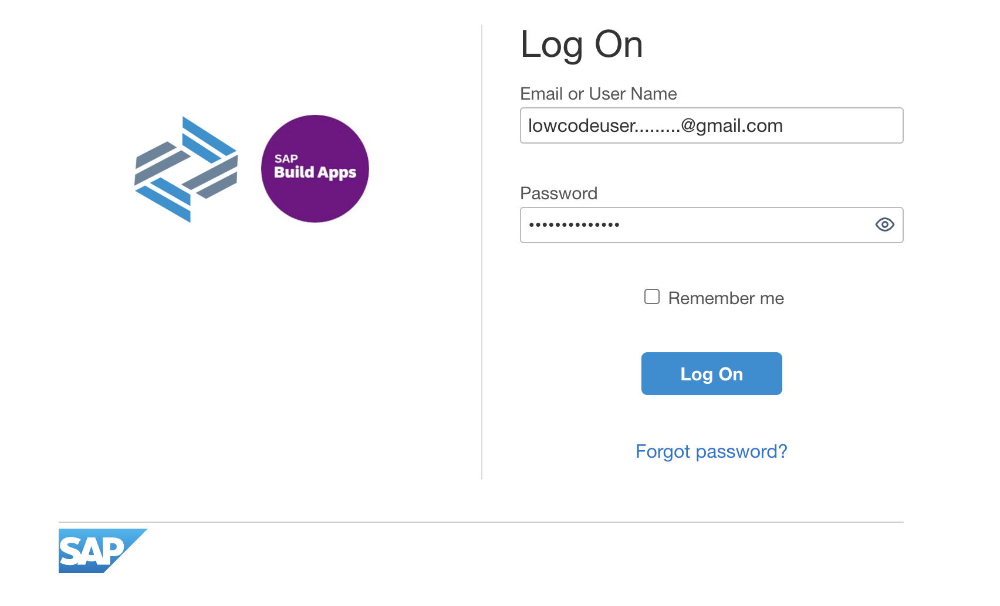
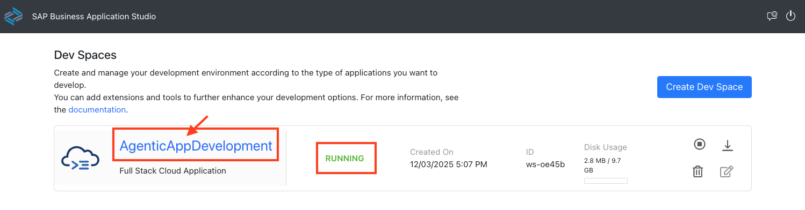
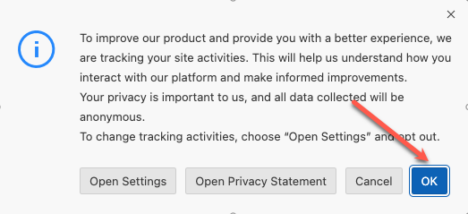
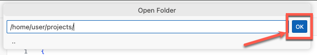
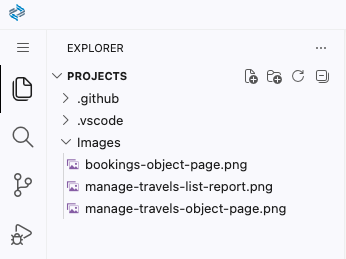
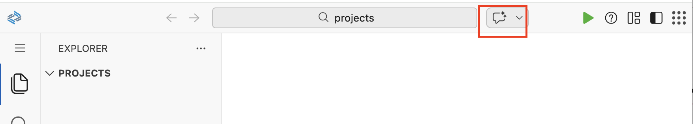
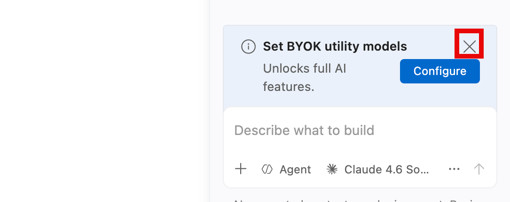
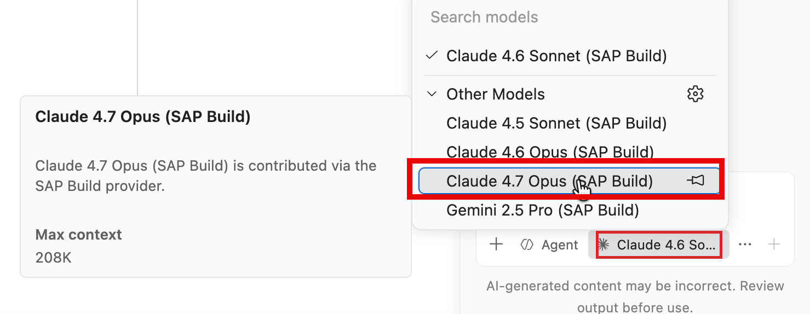

# Exercise 1.0 - Set up your AI development environment

**Part 1 - Build an SAP Fiori elements app with AI**

In this exercise you set up your development environment in SAP Business Application Studio and configure its AI Chat, so you are ready to generate your first SAP Fiori app with AI tooling in the next exercise.

As a participant of this hands-on session, you should already be set up with access to the SAP Business Application Studio landscape used below as your development environment.

Steps:

- [1.0.1 Sign in](#101-sign-in)
- [1.0.2 Access the Dev Space Manager](#102-access-the-dev-space-manager)
- [1.0.3 Open the development space](#103-open-the-development-space)
- [1.0.4 Open your project folder](#104-open-your-project-folder)
- [1.0.5 Configure AI Chat (AI client)](#105-configure-ai-chat-ai-client)

## 1.0.1 Sign in

Open the **SAP Business Application Studio** lobby: <a href="https://lcapteched.eu10.build.cloud.sap/lobby" target="_blank" rel="noopener">https://lcapteched.eu10.build.cloud.sap/lobby</a>

Use the login credentials assigned to your number, from <a href="https://github.com/Sebastianwerner1985/163/blob/main/BAS163.md" target="_blank" rel="noopener">the credentials repository</a>.

## 1.0.2 Access the Dev Space Manager

On the SAP Build landing page, click the **Switch Product** (1) button in the top right corner and select **Dev Space Manager** (2).

## 1.0.3 Open the development space

Make sure that the development space **AgenticAppDevelopment** has the status running. If stopped, click the **start** button.

Once running, click the development space name to open it. This can take some time.

Click **OK** in the popup window to accept the tracking settings in the newly created dev space.

## 1.0.4 Open your project folder

Select the **explorer icon** on the left side.

Select **Open Folder**.

Select the **projects** folder from the drop down.

Click **OK** and your window will reload.

Ensure that the projects folder has the following content.

## 1.0.5 Configure AI Chat (AI client)

SAP Business Application Studio provides [AI Chat](https://help.sap.com/docs/bas/sap-business-application-studio/ai-chat) (powered by GitHub Copilot) as your AI coding assistant. You will use it throughout the exercises.

Open **AI Chat**.

If a **Set BYOK utility models** prompt appears, dismiss it with the **X** (highlighted below) — you do not need it for this session.

Select the model **Claude 4.7 Opus (SAP Build)**.

## Summary

You have successfully set up your AI development environment with SAP Business Application Studio and configured its AI Chat.

Continue to - [Exercise 1.1 - Create a CAP project and SAP Fiori app from an image](../ex1.1/README.md)
