# Exercise 1.1 - Create a CAP project and SAP Fiori app from an image

**Part 1 - Build an SAP Fiori elements app with AI**

In this exercise you generate a working SAP Fiori elements application from an image, using the AI tooling in SAP Business Application Studio. The result is your custom app on top of an OData service created with the SAP Cloud Application Programming Model (CAP). That app and its OData service are the business knowledge the later parts build on.

Steps:

- [1.1.1 Attach the reference image](#111-attach-the-reference-image)
- [1.1.2 Run the generation prompt](#112-run-the-generation-prompt)
- [1.1.3 Review the implementation plan](#113-review-the-implementation-plan)
- [1.1.4 Confirm and let the assistant build](#114-confirm-and-let-the-assistant-build)
- [1.1.5 Run the application](#115-run-the-application)

## 1.1.1 Attach the reference image

Drag and drop the image [manage-travels-list-report.png](../../manage-travels-list-report.png) into the AI Chat window to attach it as context.


## 1.1.2 Run the generation prompt

Copy and paste the following prompt into the task input and execute the task:

```
Generate a new CAP project and SAP Fiori app based on the attached Image

- Include technical key and business key for all entities.
- Use Dollar as currency throughout the application.
- Apply criticality for travel status
- Use SAPUI5 version 1.148.12 for the generated app.

Create implementation plan first, then proceed with confirmation.
Follow all instructions and consult available MCP servers.
Do not inspect any other image files in the workspace.
```


## 1.1.3 Review the implementation plan

The AI assistant prepares an implementation plan.

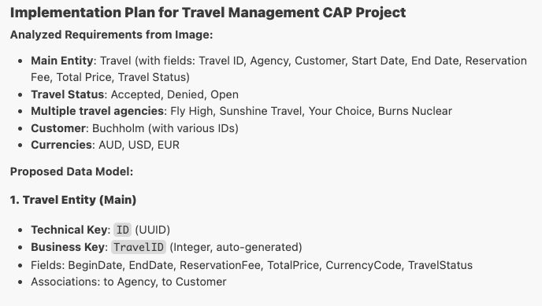

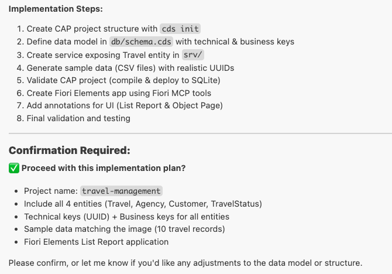

> [!NOTE]
> The implementation plan may differ from the example shown above. The images are for reference only.

## 1.1.4 Confirm and let the assistant build

When prompted to proceed with the implementation plan, confirm by typing "Yes" or "Proceed".

Click **Allow** when prompted to run Bash commands.

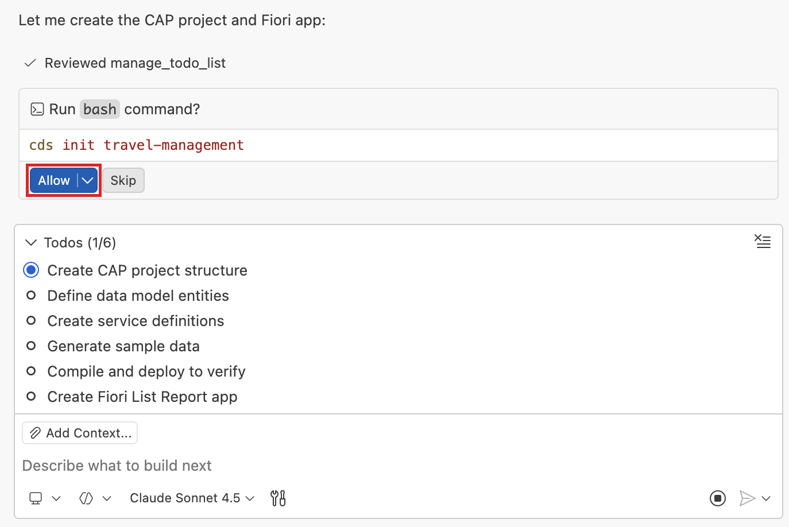

> [!CAUTION]
> If you encounter the error "The prompt was not accepted due to safety violations", simply ask the assistant to retry the request. 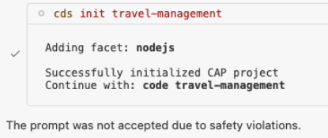

Review the files and content created by the assistant, then click **Keep** to accept them.


If the assistant reaches the maximum number of requests allowed per turn in agent mode, click **Continue** to resume the implementation.


After completing all the to-dos, the assistant confirms the successful creation of the CAP project and SAP Fiori app.

## 1.1.5 Run the application

The assistant presents a **Run** panel with the commands to start the app. Copy the `cd` command shown in the panel.


1. Click the search bar at the top of SAP Business Application Studio and type `>create new terminal`.

    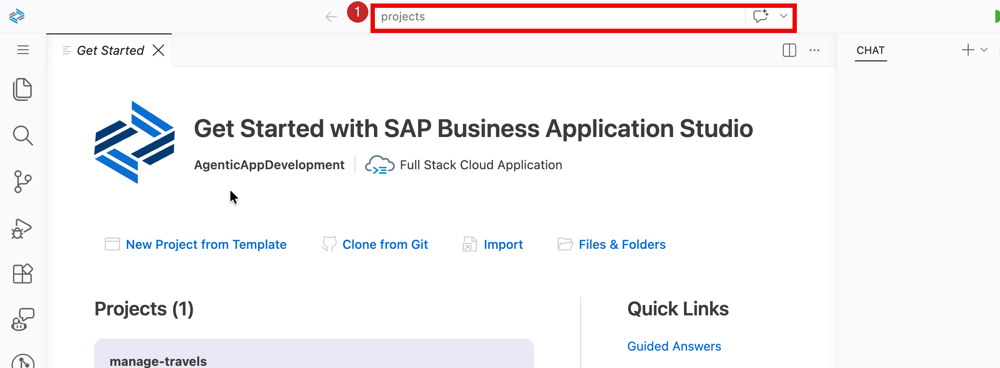

2. Select **Terminal: Create New Terminal** (1). A terminal opens at the bottom of the screen (2). Paste the `cd` command there and press `Enter`.

    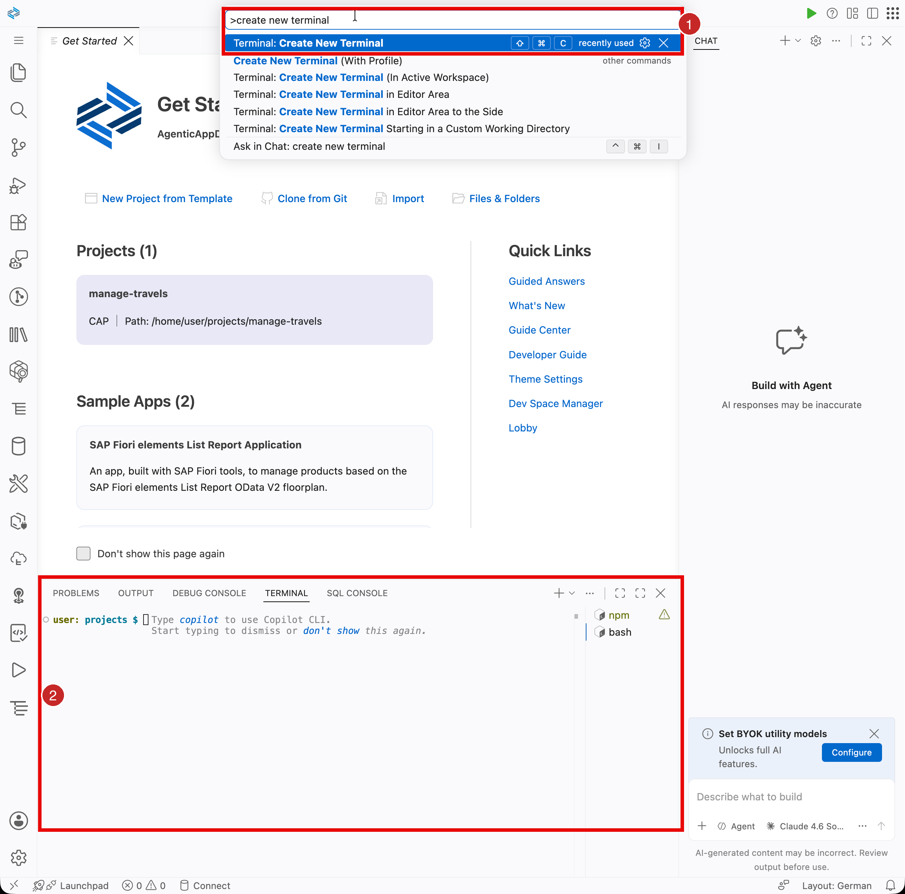

The application opens in your browser. Click **Go** to load the travel list.

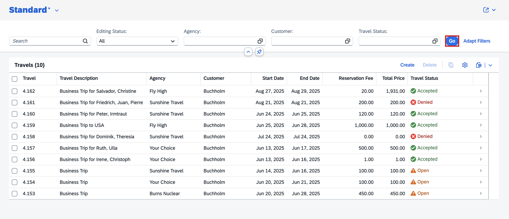

You now have a working, custom SAP Fiori elements application running on a CAP OData service, built with AI tooling.

Continue to - [Exercise 1.2 - Enable automatic data loading in List Report](../ex1.2/README.md)

## Troubleshoot

1. The application preview does not open automatically in the browser:

    - Stop any running processes using `Ctrl+C`, then delete all terminal windows, including any hidden ones.

        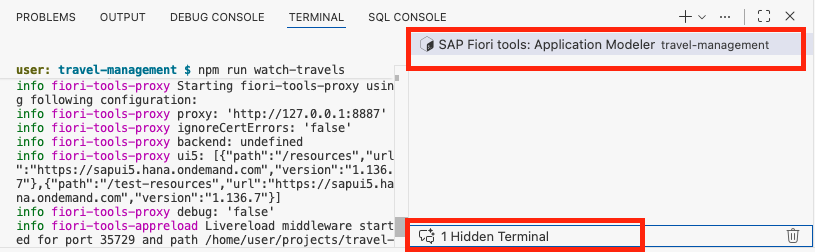

    **Option 1:**

    - Right-click on the Fiori app and select the watch script. **Important:** keep the application preview terminal running, do not close it.

        

        

    **Option 2:**

    - You can start the watch script manually:
        - Open the **package.json** file.
        - Right-click on the **watch** script and select **Run Script**.

        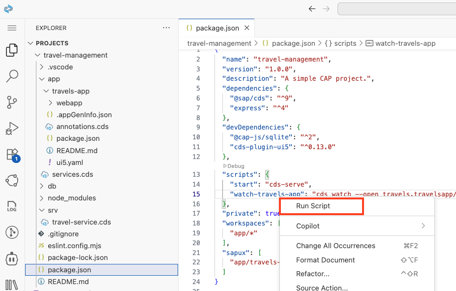

2. `ENOSPC: System limit for number of file watchers reached`

    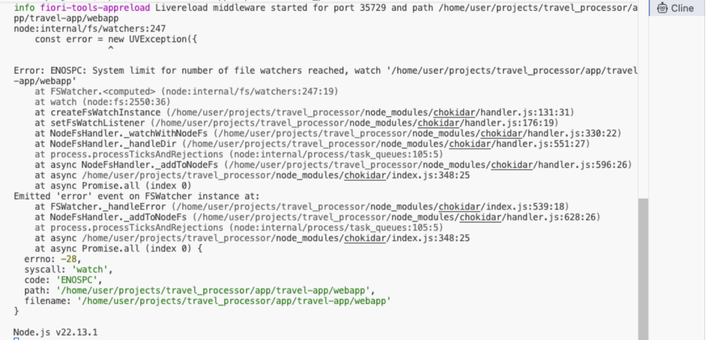

    Add the following to the **package.json** file:

    ```
    "cds": {
        "watch": {
            "excludes": [
                "**/node_modules",
                "**/target",
                "db/data.sqlite"
            ]
        }
    }
    ```

    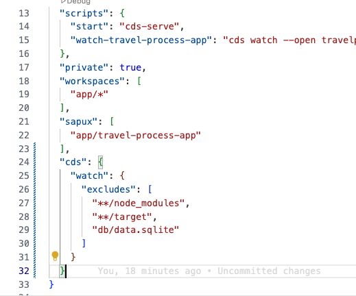

3. If HTTP port 4004 is already in use, press `Enter` to restart the preview with a different port number.

> [!NOTE]
> Ensure that you either use 4004 or the system-assigned port for the preview. Check terminal instances and delete any duplicate processes running to preview the application.

4. If the application prompts for authentication, use username `dummy` and password `dummy`.

5. In the browser, if your application does not load or displays a blank page:

    - Open Developer Tools in your browser by pressing `F12` or `Ctrl` + `Shift` + `I` (Windows/Linux) / `Cmd` + `Option` + `I` (macOS).

        

    - For a 404 error, enter the prompt:
        ```
        Error: Could not load metadata: 404 Not Found
        ```
        - Press `Enter` and the assistant will fix the service URL path issue.

    - For a 200 error, enter the prompt:
        ```
        Check if the EDM JSON expression ($edmJson) syntax is incorrect and validate it using CAP MCP.
        ```
    - If the 200 error still exists, enter this prompt:
        ```
        Remove all instances of EDM JSON ($edmJson) expression syntax from the code.
        ```

## Summary

You have successfully created a CAP project with an SAP Fiori elements application from an image.

Continue to - [Exercise 1.2 - Enable automatic data loading in List Report](../ex1.2/README.md)
