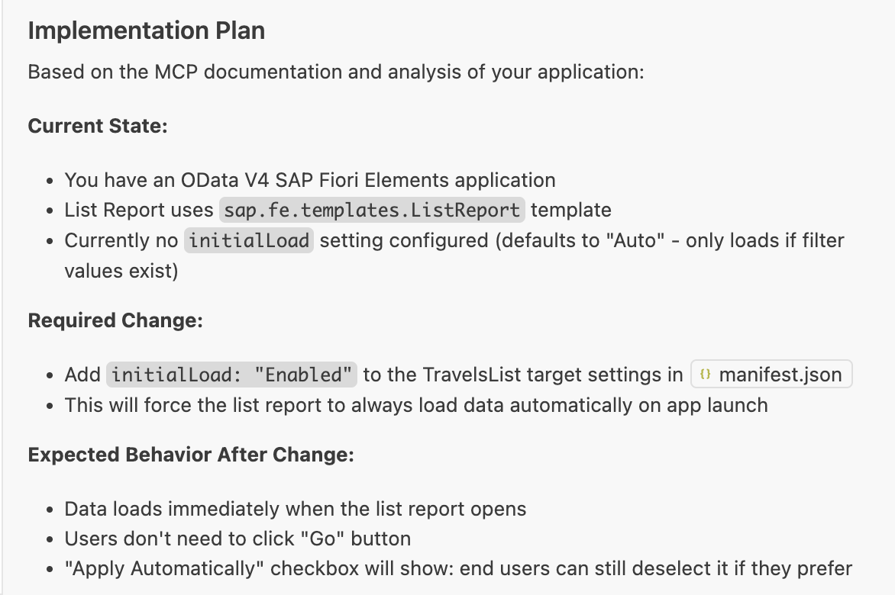
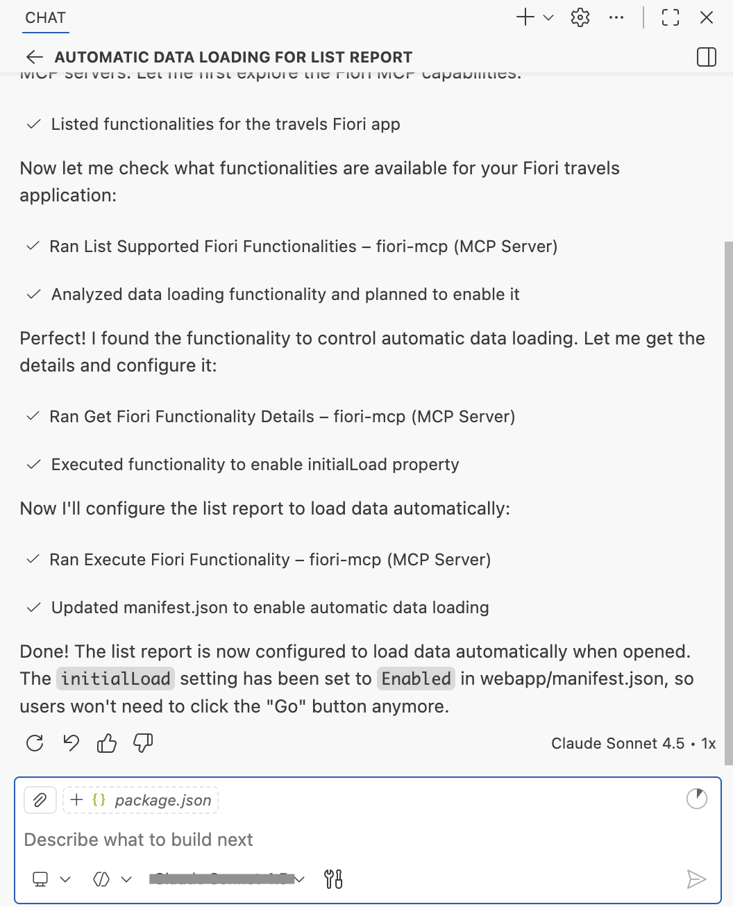

# Exercise 1.2 - Enable automatic data loading in List Report

**Part 1 - Build an SAP Fiori elements app with AI**

In this exercise you enhance the generated SAP Fiori elements List Report so that data is loaded automatically when the page opens, removing the need for the user to press the **Go** button. You drive the change through AI Chat with an implementation plan you review and confirm.

Steps:

- [1.2.1 Start a new chat](#121-start-a-new-chat)
- [1.2.2 Run the auto-load prompt](#122-run-the-auto-load-prompt)
- [1.2.3 Review the implementation plan](#123-review-the-implementation-plan)
- [1.2.4 Confirm and verify the result](#124-confirm-and-verify-the-result)

## 1.2.1 Start a new chat

Create a new chat.


## 1.2.2 Run the auto-load prompt

Copy and paste the following prompt into the task input:

```
I want the data to load automatically when I open the list report.
Create implementation plan first, then proceed with confirmation.
Consult MCP servers.
```

## 1.2.3 Review the implementation plan

Execute the prompt. Copilot prepares an Implementation Plan.



## 1.2.4 Confirm and verify the result

Confirm the implementation plan by responding with "Yes" or "Proceed".



When the task is complete, verify the data is loaded on the list report table without pressing the **Go** button.

## Summary

You have successfully enabled automatic data loading in the List Report, eliminating the need for users to press the **Go** button.

Continue to - [Exercise 1.3 - Add destination column to List Report table](../ex1.3/README.md)
