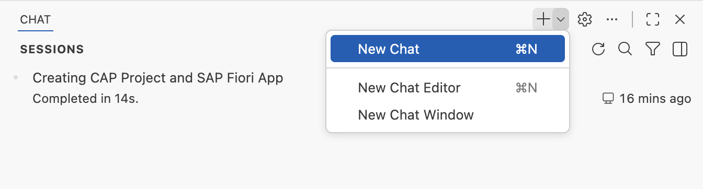
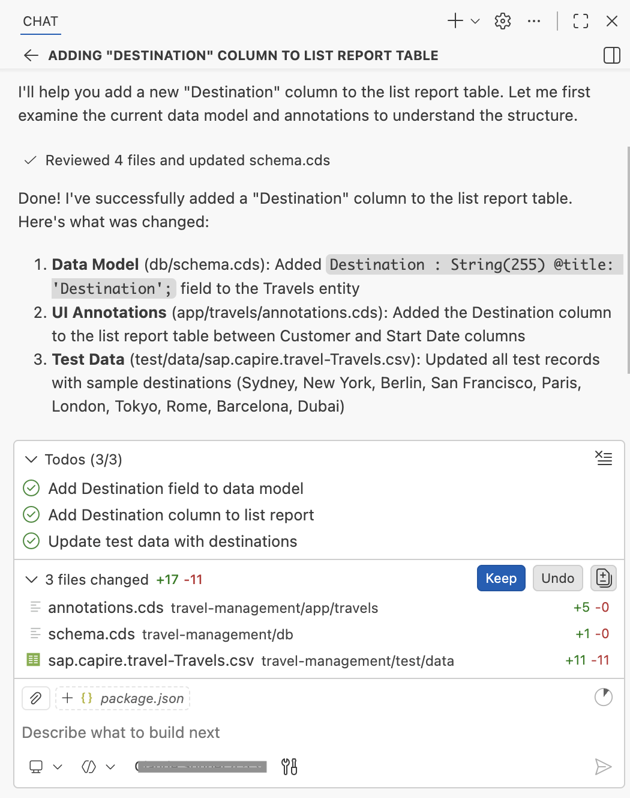
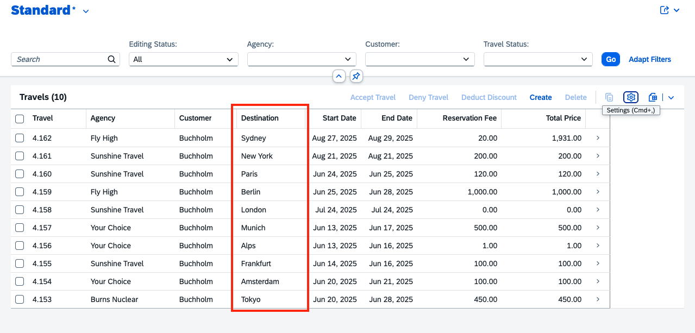

# Exercise 1.3 - Add destination column to List Report table

**Part 1 - Build an SAP Fiori elements app with AI**

In this exercise you extend the generated List Report with a new **Destination** column, letting users see trip destinations directly in the table. You again drive the change through AI Chat with an implementation plan you review and confirm.

Steps:

- [1.3.1 Start a new chat](#131-start-a-new-chat)
- [1.3.2 Run the add-column prompt](#132-run-the-add-column-prompt)
- [1.3.3 Review the implementation plan](#133-review-the-implementation-plan)
- [1.3.4 Verify the destination column](#134-verify-the-destination-column)

## 1.3.1 Start a new chat

Create a new chat.



## 1.3.2 Run the add-column prompt

Copy and paste the following prompt into the task input:

```
Create and add a new column "Destination" to the list report table.
Create implementation plan first, then proceed with confirmation.
Consult MCP servers.
```

## 1.3.3 Review the implementation plan

Execute the prompt. Copilot prepares an Implementation Plan.



## 1.3.4 Verify the destination column

After completion, verify the destination column appears in the list report.



## Summary

You have successfully added a destination column to the List Report table.

Continue to - [Exercise 1.4 - Add Analytical Chart to List Report Page](../ex1.4/README.md)
