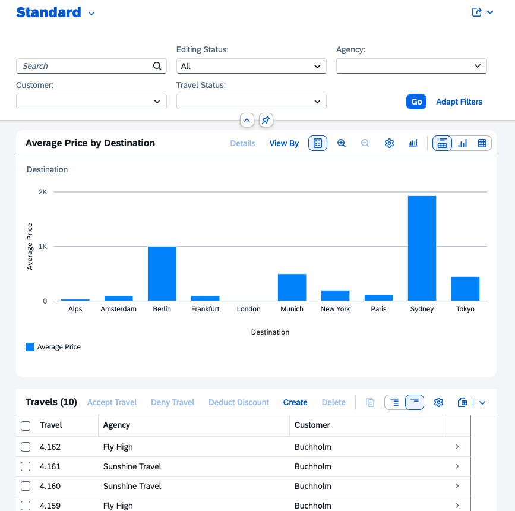

# Exercise 1.4 - Add an analytical column chart to the List Report

**Part 1 - Build an SAP Fiori elements app with AI**

In this exercise you add an analytical column chart to the List Report, turning it into an Analytical List Page (ALP) that visualises the sum of total price per destination above the table. You drive the change through AI Chat using the dedicated SAP Fiori analytical chart skill.

Steps:

- [1.4.1 Start a new chat](#141-start-a-new-chat)
- [1.4.2 Run the analytical chart prompt](#142-run-the-analytical-chart-prompt)
- [1.4.3 Verify the analytical chart](#143-verify-the-analytical-chart)
- [1.4.4 Troubleshooting](#144-troubleshooting)

## 1.4.1 Start a new chat

Create a new chat.


## 1.4.2 Run the analytical chart prompt

Enter the prompt in the task input:

```
/sap-fiori-analytical-chart
Add an analytical column chart to the List Report (ALP) 
that displays the sum of total price per destination. 
Show analytical chart above table.
```

Execute the prompt. Copilot will consult the skill on how to implement analytical charts.

## 1.4.3 Verify the analytical chart

After completion, verify that the analytical chart and table are displayed on the list report page.



## 1.4.4 Troubleshooting

- If the chart is not visible on the list report page, execute the following prompt: `In Manifest, views.paths must be at the settings level, not inside controlConfiguration`

- If you see `[50017] - Invalid data binding`, execute the following prompt: `/sap-fiori-analytical-chart verify analytical chart implementation`

- If you see `Invalid data - Some measures have different units` because test data might have mixed currencies, execute the following prompt: `Some measures have different units. Use Dollar as currency throughout the application`

## Summary

You have successfully added an analytical column chart displaying average price per destination to the List Report page.

Continue to - [Exercise 2.0 - Modify travel object page based on Image](../ex2.0/README.md)
