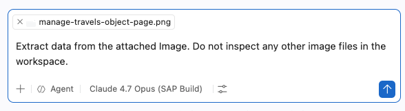
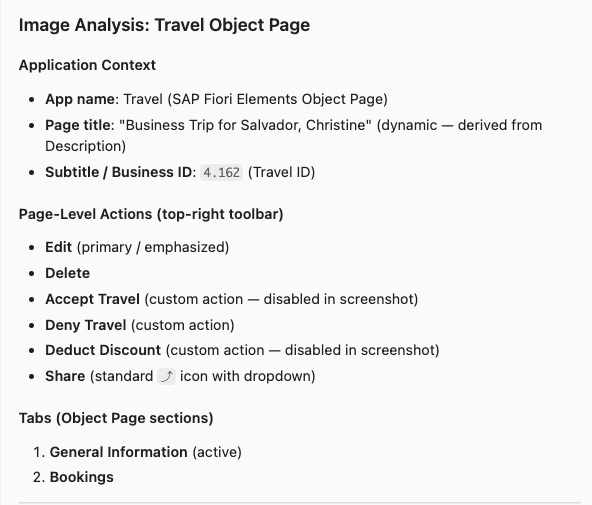
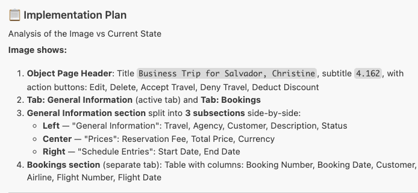
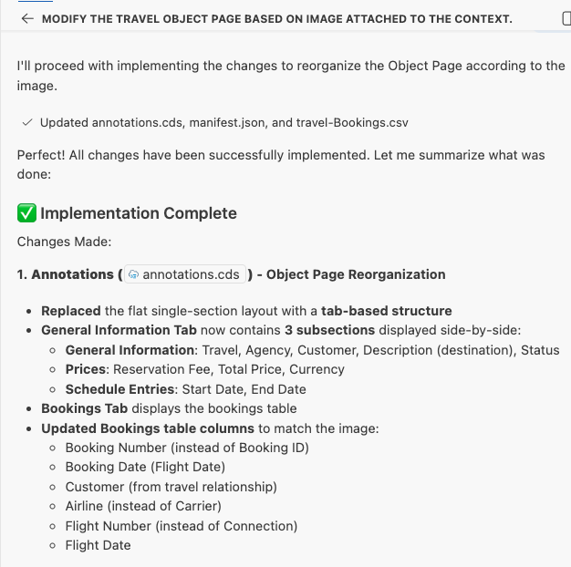
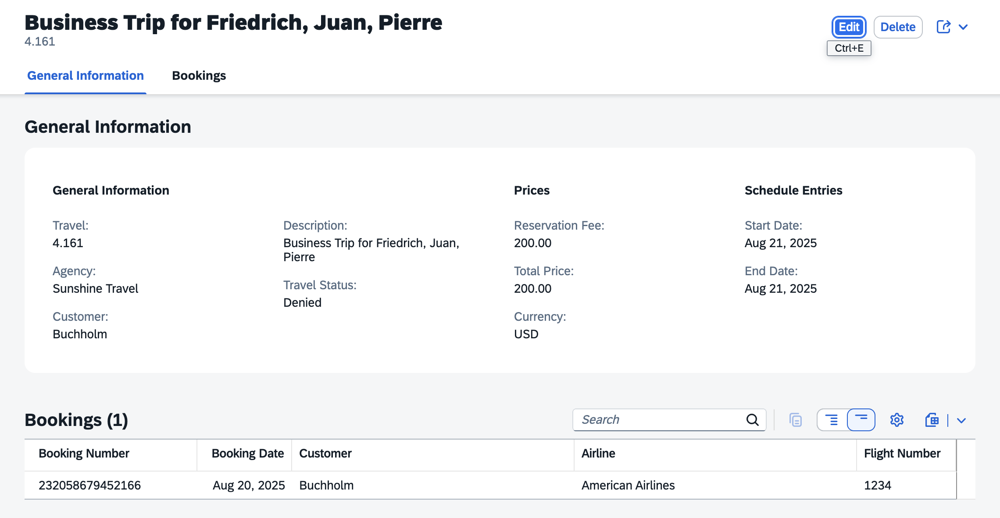

# Exercise 2.0 - Modify travel object page based on image

**Part 1 - Build an SAP Fiori elements app with AI**

In this exercise you refine the Travel object page of your generated SAP Fiori elements app to match a provided design. You use the attached image as a reference, let AI Chat extract its structure, then regenerate the object page — reorganising the General Information section, aligning fields, and adding a bookings table below.

Steps:

- [2.0.1 Start a new chat and attach the image](#201-start-a-new-chat-and-attach-the-image)
- [2.0.2 Extract data from the image](#202-extract-data-from-the-image)
- [2.0.3 Run the object page modification prompt](#203-run-the-object-page-modification-prompt)
- [2.0.4 Review and confirm the implementation plan](#204-review-and-confirm-the-implementation-plan)
- [2.0.5 Verify the object page](#205-verify-the-object-page)
- [2.0.6 Troubleshoot](#206-troubleshoot)

## 2.0.1 Start a new chat and attach the image

Create a new chat.


Drag and drop the image [manage-travels-object-page.png](../../manage-travels-object-page.png) from the images folder into the Copilot Chat window to attach it as context.

## 2.0.2 Extract data from the image

Copy and paste the following prompt into the task input and execute the task:

```
Extract data from the attached Image. Do not inspect any other image files in the workspace.
```



Verify that the extracted data matches the image.



## 2.0.3 Run the object page modification prompt

Copy and paste the following prompt into the task input and execute the task:

```
Modify the travel object page based on the extracted data:

- Reorganize the General Information section into subsections as shown in the image.
- Align all fields, sections, and structure precisely with the image.
- Add a bookings table section below.
- Use Dollar as currency.
- Generate mock data for the bookings table.

Create an implementation plan first, then proceed after confirmation.

```

## 2.0.4 Review and confirm the implementation plan

Copilot prepares an implementation plan.



Confirm the implementation plan by responding with "Yes" or "Proceed".



## 2.0.5 Verify the object page

After completion, verify the object page in the application preview:
- Verify the object page header contains both title and description.
- Make sure the fields in the **General Information** section are arranged as per the Image uploaded to the context.



## 2.0.6 Troubleshoot

- The booking table does not appear below General Information section.
    Execute the prompt: `Change section layout to page for travel object page`.

- If the object page title is not visible, execute the prompt: `Object page title not visible`

    

## Summary

You have successfully modified the travel object page based on the Image, including the bookings table section.

Continue to - [Exercise 2.1 - Add Custom Section with RichTextEditor Building Block](../ex2.1/README.md)
