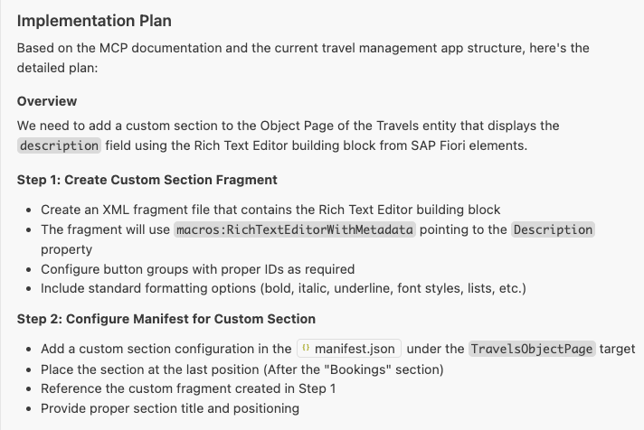
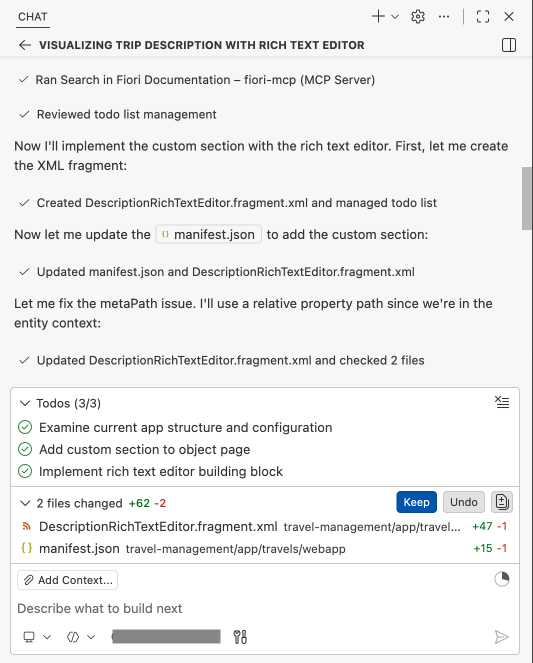
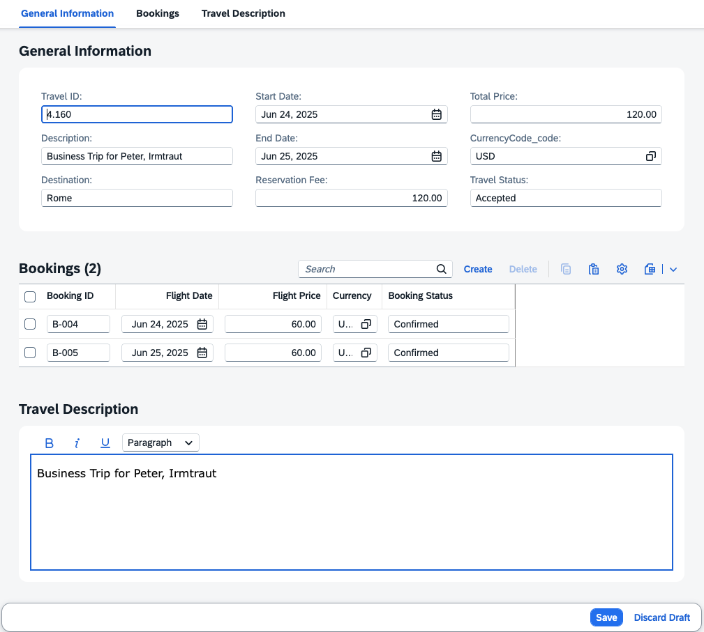

# Exercise 2.1 - Add Custom Section with RichTextEditor Building Block

**Part 1 - Build an SAP Fiori elements app with AI**

In this exercise you add a custom section to the Travel object page and surface the trip description in a RichTextEditor building block. You then edit the description with formatting at runtime and save it back as a draft, demonstrating how AI tooling composes additional UI building blocks into a Fiori elements app.

Steps:

- [2.1.1 Start a new chat](#211-start-a-new-chat)
- [2.1.2 Run the custom section prompt](#212-run-the-custom-section-prompt)
- [2.1.3 Review and confirm the implementation plan](#213-review-and-confirm-the-implementation-plan)
- [2.1.4 Verify the RichTextEditor at runtime](#214-verify-the-richtexteditor-at-runtime)
- [2.1.5 Troubleshoot](#215-troubleshoot)

## 2.1.1 Start a new chat

Create a new chat.


## 2.1.2 Run the custom section prompt

Enter the following prompt in the task input:

```
Your task is to visualize the description field of the trip as a rich text editor on the object page of the travel management app. Implement in two steps:
 1. Add a custom section at the last position of the object page
 2. Use the rich text editor building block in the new section to show the description field. Ensure each button group for the Rich text editor has an ID
Create implementation plan first, then proceed with confirmation.
Consult MCP servers.

```

Execute the task.



## 2.1.3 Review and confirm the implementation plan

Confirm the implementation plan by responding with "Yes" or "Proceed".



## 2.1.4 Verify the RichTextEditor at runtime

After completion, verify that the travel description section is visible on the travel object page.

Click the **Edit** button in the top right corner.

In the travel description section, select some text and apply bold formatting.

Click **Save** and verify that the object has been saved successfully.



## 2.1.5 Troubleshoot

1. No **Edit** button on the travel object page. Execute the prompt:
    ```
    Enable draft mode for travel entity
    ```

## Summary

You have successfully added a custom section with a RichTextEditor building block to the travel object page.

Continue to - [Exercise 3.0 - Add Object Page for Booking Details](../ex3.0/README.md)
