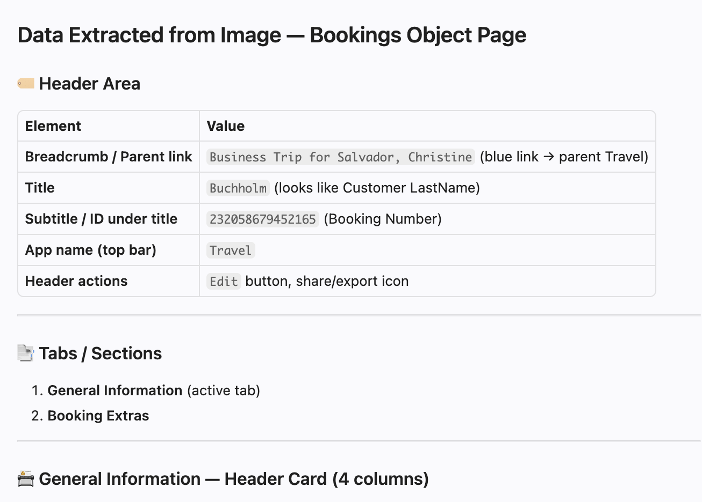
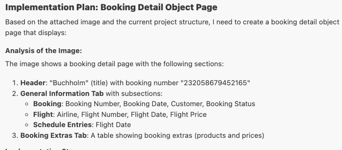
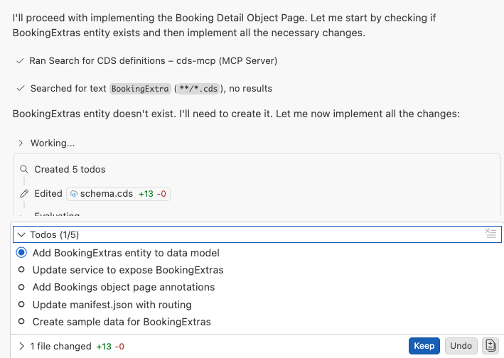
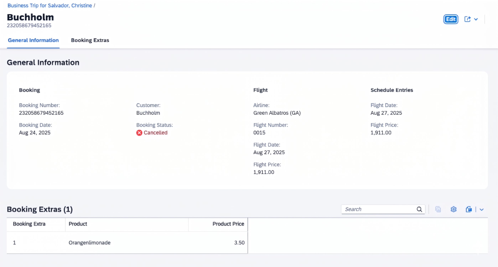

# Exercise 3.0 - Add Object Page for Booking Details

**Part 1 - Build an SAP Fiori elements app with AI**

In this exercise you add a dedicated object page for booking details, driven by a second reference image. You let AI Chat extract the image's structure, generate the new object page, and wire up navigation from the bookings table on the Travel object page — completing the end-to-end flow of your SAP Fiori elements app.

Steps:

- [3.0.1 Start a new chat and attach the image](#301-start-a-new-chat-and-attach-the-image)
- [3.0.2 Extract data from the image](#302-extract-data-from-the-image)
- [3.0.3 Run the booking object page prompt](#303-run-the-booking-object-page-prompt)
- [3.0.4 Review and confirm the implementation plan](#304-review-and-confirm-the-implementation-plan)
- [3.0.5 Verify the booking object page](#305-verify-the-booking-object-page)
- [3.0.6 Troubleshoot](#306-troubleshoot)

## 3.0.1 Start a new chat and attach the image

Create a new chat.


Drag and drop the image [bookings-object-page.png](../../bookings-object-page.png) from the images folder into the Copilot Chat window to attach it as context.

## 3.0.2 Extract data from the image

Copy and paste the following prompt into the task input and execute the task:

```
Extract data from the attached Image. Do not inspect any other image files in the workspace.
```

Verify that the extracted data matches the image.



## 3.0.3 Run the booking object page prompt

Copy and paste the following prompt into the task input and execute the task:

```
Create a booking detail object page based on the extracted data.
- Use Dollar as currency.
- Generate mock data.

Create implementation plan first, then proceed with confirmation.
Consult MCP servers.
```

## 3.0.4 Review and confirm the implementation plan

Copilot prepares an implementation plan.



Confirm the implementation plan by responding with "Yes" or "Proceed".



## 3.0.5 Verify the booking object page

After completion, navigate to the Travel object page and click on a row in the bookings table to open the booking object page. Verify the booking object page appears correctly in the application preview.



## 3.0.6 Troubleshoot

- Booking Extras table does not appear below General Information section.
    Execute the prompt: `Change section layout to page for booking object page`.
- The booking table doesn't have navigation to object page. Execute the prompt `Ensure manifest configuration for new object page`.
- Section **Booking Extras** is missing in the booking object page. Execute the prompt: `booking extras table section is missing`.
- The Booking Extras table has no data. Execute the prompt: `add mock data for booking extras`.
- Error `Composition in draft-enabled entity can't lead to another entity with "@odata.draft.enabled" (in entity:"TravelService.Travel"/element:"Bookings")`. Copy and paste error message to Copilot to fix the issue.

## Summary

Congratulations, you have completed Part 1! You built an SAP Fiori elements travel application end-to-end with the help of SAP's AI developer tooling.

In Part 2, you switch from developer to end user and explore a ready-to-run SAP Fiori elements app in which AI assists the business user directly at runtime.

Continue to - [Exercise 4 - Set up for Part 2: open the AI-enabled Travel app](../ex4.0/README.md)
