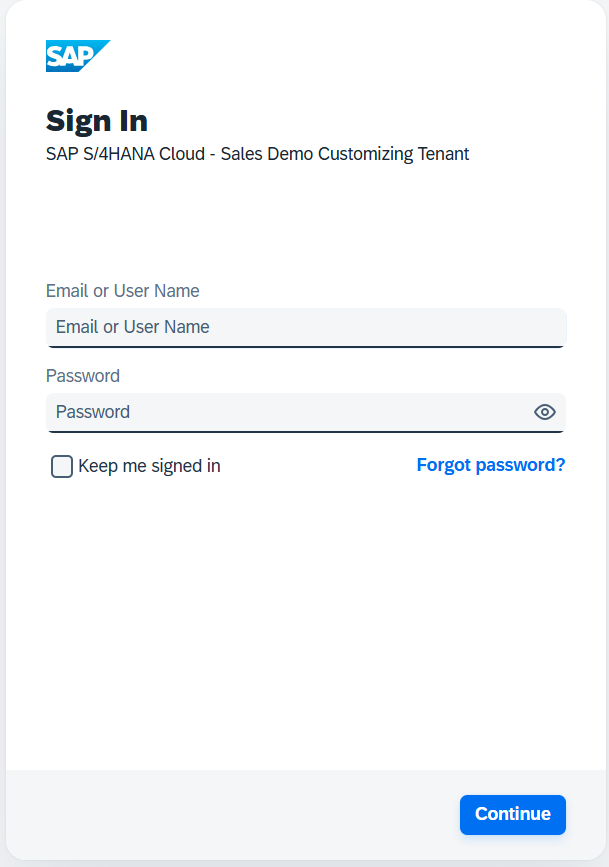
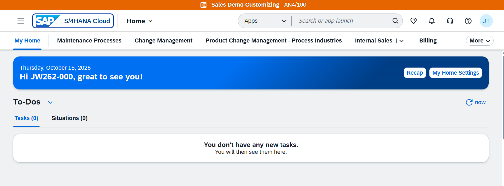
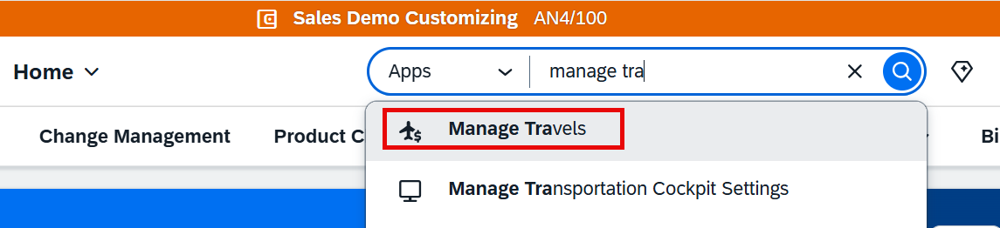

# Exercise 4 - Set up for Part 2: open the AI-enabled Travel app

In Part 1 you acted as a developer and built an SAP Fiori elements travel application with the help of SAP's AI developer tooling. In Part 2 you change perspective and become an end user.

You will now work with a ready-to-run SAP Fiori elements travel application on SAP S/4HANA Cloud. This application is already deployed for you - there is nothing to build in this part. What makes it special is that AI is built into the running app: while you work with travel data, AI assists you directly in the user interface.

In the following exercises you will explore several of these runtime AI capabilities hands-on. This exercise gets you logged in and into the app.

## About the AI-assisted features

The four AI-assisted features you try in exercise 4 are standard **base AI** capabilities embedded in every SAP Fiori elements app once the administrator has enabled them.

Available in **SAP S/4HANA Cloud Public Edition** (release 2608 and later), on customer development, test, and production systems and on partner demo and test systems. Enablement details, prerequisites, and regional availability are described in the references below.

**References**
- SAP Help - [Enabling AI-Assisted Features](https://help.sap.com/docs/SAP_S4HANA_CLOUD/4fc8d03390c342da8a60f8ee387bca1a/96587a490f064cb0aaf7971302cfe3a0.html)
- SAP Help - [Using AI-Assisted Features](https://help.sap.com/docs/SAP_S4HANA_CLOUD/4fc8d03390c342da8a60f8ee387bca1a/e155d01c9d5f4280825bdc10dd63ba19.html)
- SAP Note [3692870](https://me.sap.com/notes/3692870) - Configuration of Base AI-Assisted Features in SAP S/4HANA Cloud Public Edition
- SAP Note [3651017](https://me.sap.com/notes/3651017) - Activation of SAP Business AI Features in SAP S/4HANA Cloud Public Edition

## System and user information

| | |
| --- | --- |
| Launchpad URL | https://my426786.s4hana.cloud.sap/ui |
| Your user | `jw262-NNN@education.cloud.sap` |
| User number `NNN` | assigned by your instructor, in the range `001` to `041` |
| Your password | from [the credentials repository](https://github.com/Sebastianwerner1985/262/blob/main/FioriAI.md) |

> [!NOTE]
> Each participant uses an individual user. Please use the user assigned to you and do not share it, so that the travel data you work with stays your own during the session.

## Prerequisites

- A modern web browser (Google Chrome or Microsoft Edge recommended).
- Your participant user and password (see the table above).

## Log on to SAP S/4HANA Cloud

1. Open the launchpad URL https://my426786.s4hana.cloud.sap/ui in a new browser tab.

    

2. Enter the participant user and password from [the credentials repository](https://github.com/Sebastianwerner1985/262/blob/main/FioriAI.md) and sign in.

3. The SAP Fiori launchpad opens and shows the **My Home** page.

    

## Open the Travel app

1. On the **My Home** page, use the search bar in the top right corner of the launchpad. Make sure the search scope is set to **Apps**.

    

2. Type `manage travel` into the search bar and start the search.

3. From the search results, open the **Manage Travels** app. The app opens on its list report, showing a table of travels.

    <!-- TODO: add screenshot of the opened list report -->
    <!--  -->

    > [!NOTE]
    > The tile is registered twice on this tenant: the search finds it as **Manage Travels**, while the running app and the **Recently Used** list refer to it as **Travel Management**. Both open the same list report, so in later exercises you can safely use either name.

    > [!TIP]
    > After you launch the app for the first time, it also appears under **Recently Used** on your **My Home** page (as **Travel Management**), so you can reopen it directly from there in later exercises without searching again.

4. Take a moment to get oriented:
    - The filter bar at the top lets you narrow down the list of travels.
    - The table shows the travels with their key information.
    - Selecting a row opens the object page with the details of a single travel.

You are now set up for Part 2 and ready to explore how AI assists you while working with this application.

## Summary

You have logged on to SAP S/4HANA Cloud, opened the **My Home** page, and launched the Travel application.

In the next exercises you will use the built-in AI capabilities of the app to work with travel data more efficiently.

Continue to - [Exercise 4.1 - AI-assisted easy filter](../ex4.1/README.md)
