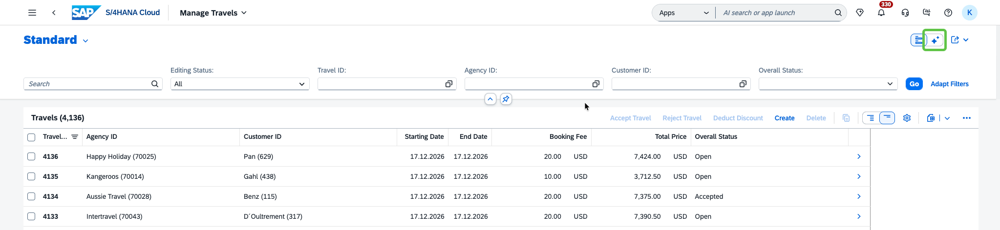
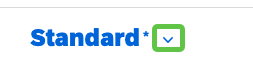
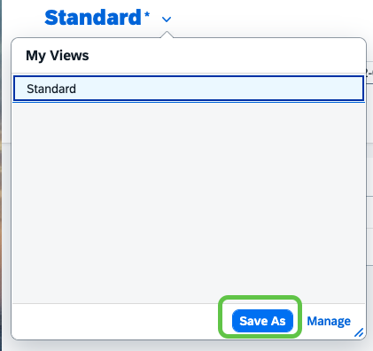
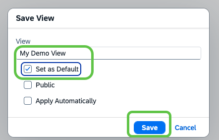
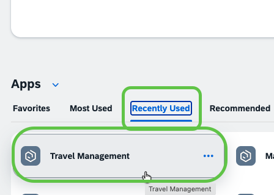
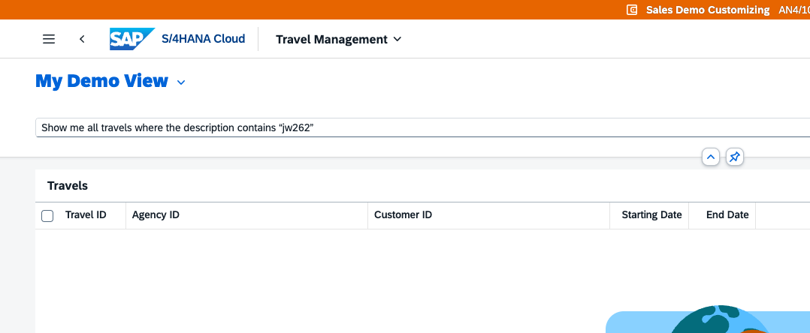
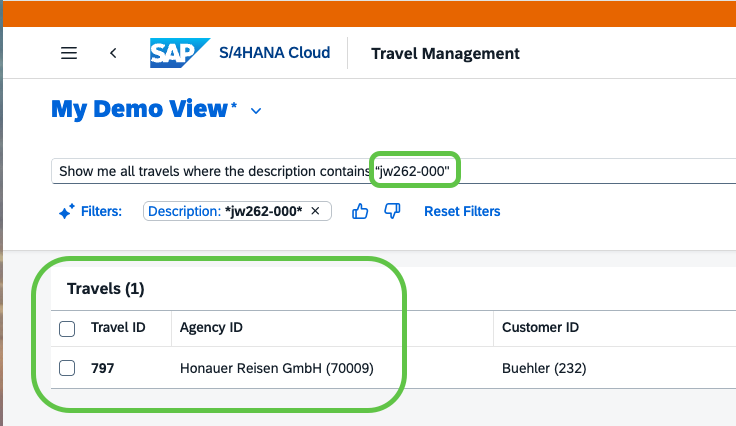

# Exercise 4.1 - AI-assisted easy filter

In this exercise you will use the **AI-assisted easy filter** on the list report of the Travel app. Instead of applying filters one by one in the filter bar, you describe what you want to see in natural language and let the AI translate it into the matching filters.

## Prerequisites

- You have completed [Exercise 4.0](../ex4.0/README.md) and the Travel app is open on its list report.

## Switch to AI mode

1. On the list report, locate the **filter mode toggle** in the top right corner of the page. The two icon buttons switch between **Classic mode** (list icon) and **AI mode** (sparkles icon).

2. Click the sparkles icon to switch to **AI mode**. A single search field appears with the placeholder *Enter your query using natural language to filter the list* and a **Go** button.

    

## Run a natural-language query

1. In the AI mode search field, type the following query:

    ```
    Show me all travels where the description contains "jw262"
    ```

2. Press **Enter** (or click the **Go** button). You now see all travels related to this session.

## Save the query as a variant

Save the query as a variant so you can reuse it as your entry point to the application in later exercises.

1. In the top left of the list report, click the arrow next to the **Standard** variant.

    

2. From the opened menu, click **Save As**.

    

3. In the **Save View** dialog, enter a name for the variant (for example `My Demo View`), tick the **Set as Default** checkbox, and click **Save**.

    

## Verify the variant is applied on reopen

1. Click the **SAP** logo in the top left of the header to leave the application and navigate back to **My Home**.

    

2. On **My Home**, under **Recently Used**, click the **Travel Management** app to open it again.

    

3. The app now starts directly in **AI mode**, with your `My Demo View` variant active and the saved query already filled in.

    

## Narrow the query to your own travel

1. In the AI mode search field, extend the query by appending `-NNN` to `jw262`, where `NNN` is the three-digit user number you were assigned in exercise 4.0. The query should look like this:

    ```
    Show me all travels where the description contains "jw262-NNN"
    ```

2. Press **Enter** (or click **Go**). The list now shows your own travel.

    

## Summary

You have used the AI-assisted easy filter to query the Travel list report in natural language, saved the query as a default variant, verified that the variant is applied automatically when you reopen the app, and narrowed the query down to your own travel.

Continue to - [Exercise 4.2 - AI-assisted easy fill](../ex4.2/README.md)

