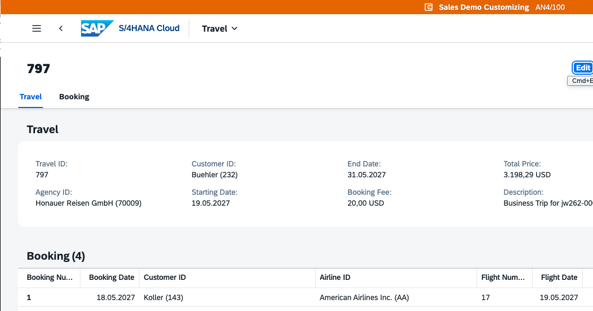
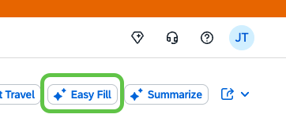
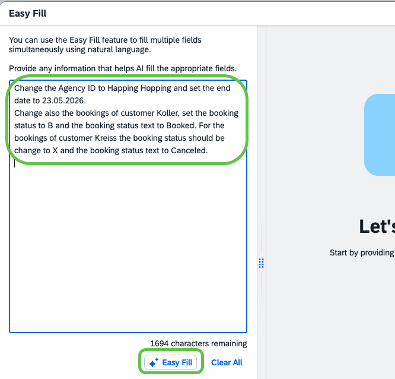
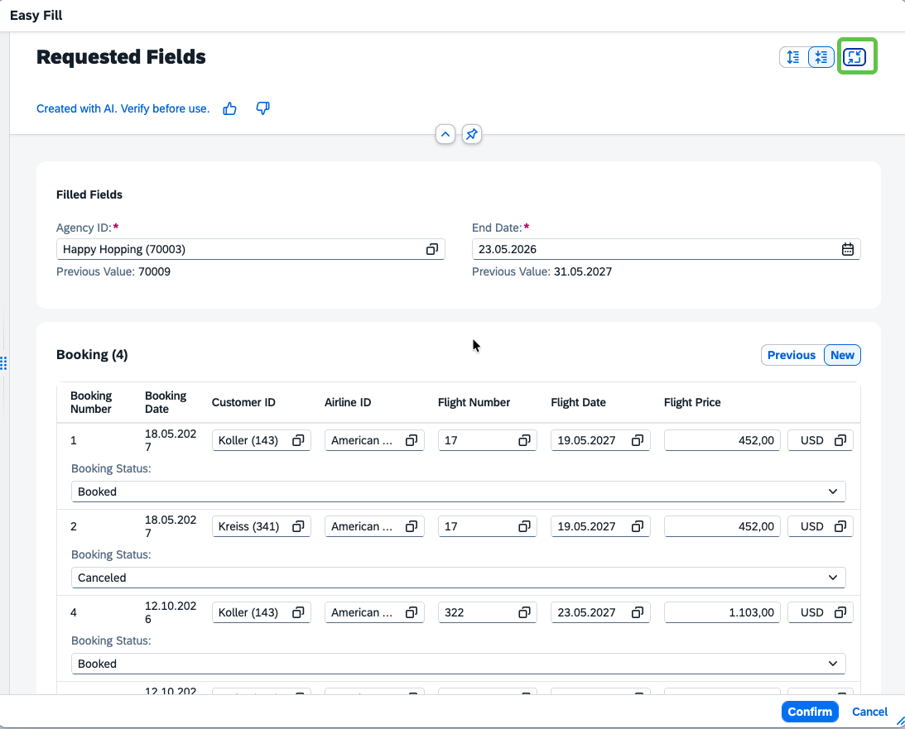
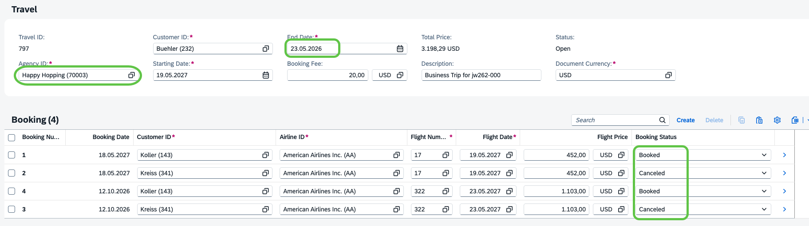

# Exercise 4.2 - AI-assisted easy fill

In this exercise you will use the **AI-assisted easy fill** on the object page of your travel. Instead of changing the header fields and the booking rows one by one, you describe the changes in natural language and let the AI apply them for you. You then review the AI's proposal in a preview, confirm it, and save the draft.

## Prerequisites

- You have completed [Exercise 4.1](../ex4.1/README.md) and the **Travel Management** app is open on its list report, filtered down to your own travel.

## Open the travel object page

1. In the list report, click the row of your own travel to navigate to the object page. The object page opens on the **Travel** tab, showing the travel header and the list of bookings below.

    

2. Click the **Easy Fill** button in the toolbar of the object page.

    

## Describe the changes in natural language

1. Copy the following text into the **Easy Fill** input field and click the **Easy Fill** button:

    ```
    Change the Agency ID to Happy Hopping and set the end date to 23.05.2026. Change also the bookings of customer Koller, set the booking status to B and the booking status text to Booked. For the bookings of customer Kreiss the booking status should be change to X and the booking status text to Canceled.
    ```

    

## Validate the suggested changes

1. Switch to the **Preview** tab in the Easy Fill dialog to see the fields and table rows the AI is going to change.

    > [!TIP]
    > Use the **Expand** button in the top-right corner of the dialog to enlarge the dialog and get more space for the review.

    

2. Review the proposed changes. In this example the AI should have interpreted the instruction as:
    - **Agency ID** → `Happy Hopping (70003)`
    - **End Date** → `23.05.2026`
    - Bookings for customer **Koller** → **Booking Status** `B`, **Booking Status Text** `Booked`
    - Bookings for customer **Kreiss** → **Booking Status** `X`, **Booking Status Text** `Canceled`

## Confirm and save

1. Click **Confirm** to apply the suggested changes to the object page.

    

2. On the object page, verify the updated header fields and booking rows one more time. The footer shows a **Draft updated** indicator.

    

Leave the draft as it is. You will save the travel in the next exercise, once you have reviewed and corrected the dates with the help of the AI-assisted error explanation.

## Summary

You have used the AI-assisted easy fill to change multiple header fields and booking rows of a travel from a single natural-language instruction, validated the proposed changes in the Preview tab, and confirmed them into the object page as a draft.

Continue to - [Exercise 4.3 - AI-assisted error explanation](../ex4.3/README.md)
