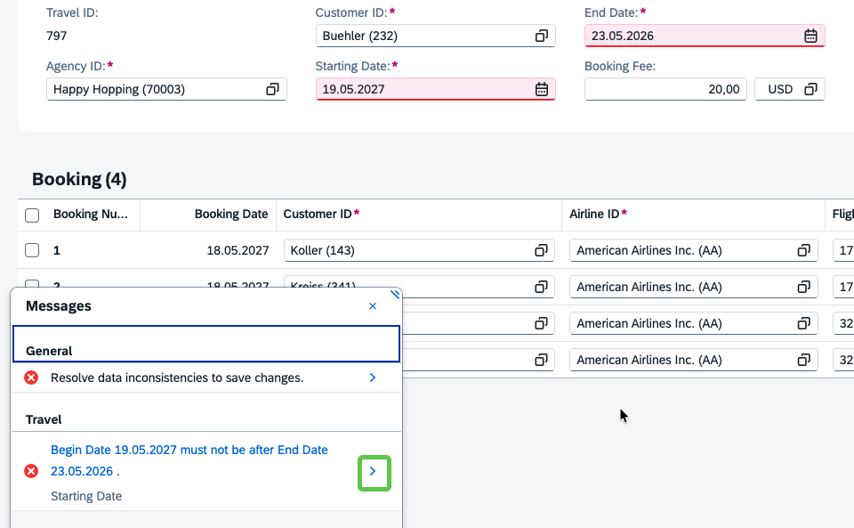
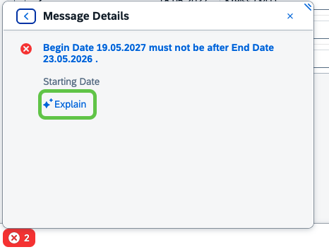
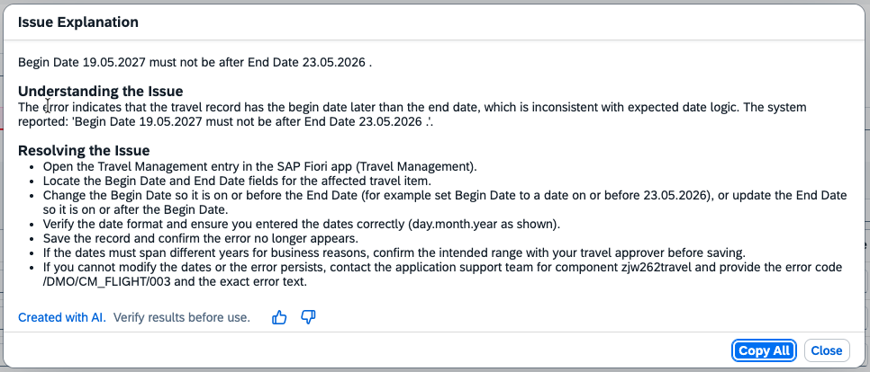
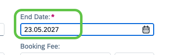

# Exercise 4.3 - AI-assisted error explanation

In the previous exercise, Easy Fill applied the end date you dictated in natural language (`23.05.2026`), but your travel's starting date is `19.05.2027`, so the end date now lies **before** the starting date. When you try to save, the travel app reports a validation error. In this exercise you use the **AI-assisted error explanation** to understand that error in plain language, then apply the suggested fix.

## Prerequisites

- You have completed [Exercise 4.2](../ex4.2/README.md) and the **Travel Management** app is open on the object page of your travel, with the Easy Fill draft from the previous exercise still active (**Starting Date** `19.05.2027`, **End Date** `23.05.2026`).

## Reveal the error

1. Save the Easy Fill draft from the previous exercise by clicking **Save** in the footer of the object page.

    

2. Ups, we maintained the end date wrong in the previous exercise. The two date fields are highlighted as invalid and a **Messages** popover opens in the bottom left showing the error `Begin Date 19.05.2027 must not be after End Date 23.05.2026 .` under the **Travel** section.

    

## Explain the error

1. To better understand the error, in the **Messages** popover click the chevron (`>`) at the right of the error row to open the **Message Details** view. The details view shows the full message and an **✨ Explain** link just below the field name (**Starting Date**).

    

2. Click **✨ Explain**. The **Issue Explanation** dialog opens and the AI generates a plain-language explanation under **Understanding the Issue** plus a bulleted list under **Resolving the Issue** with concrete steps to fix the error.

    

    > [!TIP]
    > The dialog carries a **Created with AI. Verify results before use.** disclaimer, plus thumbs-up / thumbs-down feedback buttons and a **Copy All** button that copies the full explanation to the clipboard, handy for pasting into a chat with a colleague or into a support ticket.

## Close the explanation

1. Now that you understand the error and know how to resolve it, click **Close** to dismiss the **Issue Explanation** dialog. (Optionally click **Copy All** first to copy the explanation to the clipboard.)

    

## Apply the fix

1. Back on the object page, change the **End Date** to the correct year (`23.05.2027`) and press **Enter**. The error highlight on both date fields disappears and the error entry in the **Messages** popover is gone.

    

2. Click **Save** to persist the corrected travel.

## Summary

You have used the AI-assisted error explanation to translate a technical validation message from the Travel object page into a plain-language explanation with concrete resolution steps, applied the suggested fix to the **End Date**, and saved the travel.

Continue to - [Exercise 4.4 - AI-assisted smart summarization](../ex4.4/README.md)
