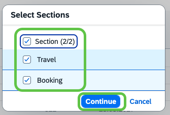
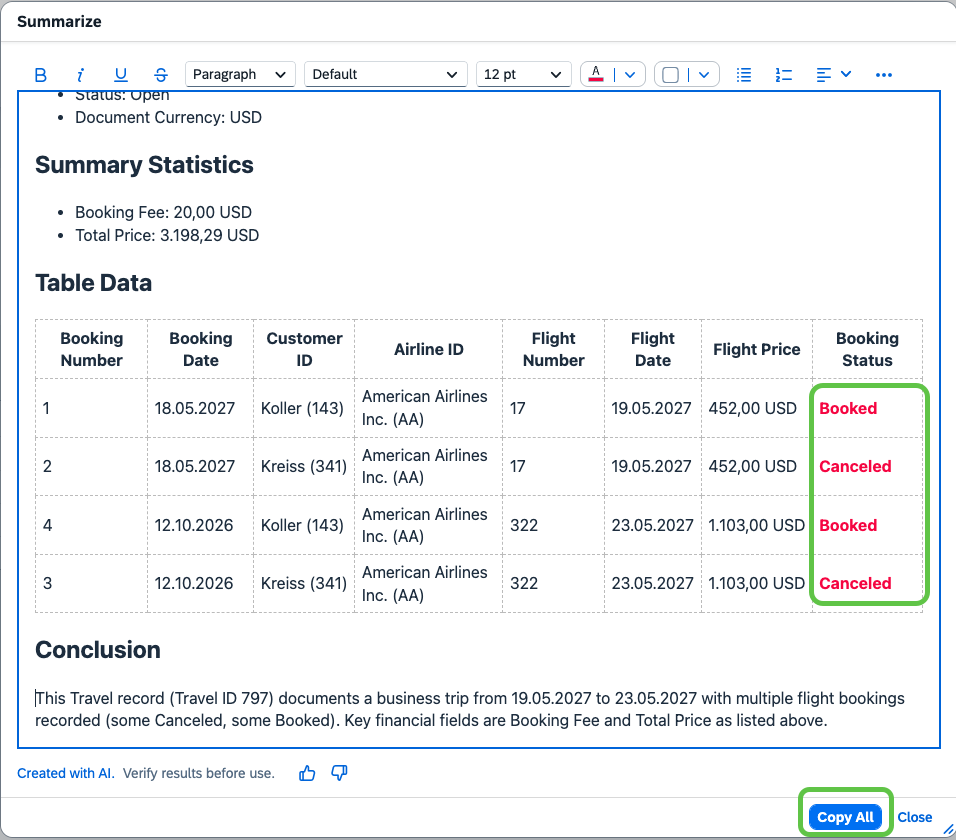

# Exercise 4.4 - AI-assisted smart summarization

In this exercise you will use the **AI-assisted smart summarization** on the object page of your travel. Instead of reading through every section and booking row yourself, you let the AI generate a concise summary of the object page in a rich-text editor that you can review, format, and copy, for example to share in an email or a chat.

## Prerequisites

- You have completed [Exercise 4.3](../ex4.3/README.md) and the **Travel Management** app is open on the object page of your travel, with the dates corrected and the travel saved.

## Trigger the summary

1. In the top right of the object page toolbar, click the **✨ Summarize** button (next to **Easy Fill**).

    

## Choose which sections to include

1. The **Select Sections** popover opens with all sections of the object page (**Travel** and **Booking**) pre-selected. Leave the defaults so the summary covers both the header and the bookings, then click **Continue**.

    

    > [!TIP]
    > Use the top-level **Section (2/2)** checkbox to select or deselect all sections at once. At least one section is required for a summary.

## Review and format the summary

1. The AI generates the summary and opens it in the **Summarize** rich-text editor. The summary is organized into sections (**Summary Statistics**, **Table Data**, **Conclusion**) and includes the key header fields, the bookings table, and a one-paragraph conclusion. Use the toolbar at the top (bold, italic, colors, lists, alignment) to format the summary, for example highlight the **Booking Status** column in red to make the Booked / Canceled distinction stand out.

    

    > [!TIP]
    > The editor carries a **Created with AI. Verify results before use.** disclaimer, plus thumbs-up / thumbs-down feedback buttons. The exact wording of the summary can differ each time you run it, so always verify the numbers against the object page before sharing.

## Share and close

1. Click **Copy All** to copy the formatted summary to the clipboard. You can now share it through your preferred channel, for example by pasting it into an email or a Microsoft Teams chat.

2. Click **Close** to dismiss the **Summarize** dialog and finalize the hands-on session.

## Summary

You have used the AI-assisted smart summarization on the Travel object page to generate a concise summary across the Travel and Booking sections, formatted the summary in the rich-text editor, and copied it to the clipboard so you can share it with others.

We hope you have enjoyed your hands-on session on the AI-assisted features in SAP Fiori elements.
